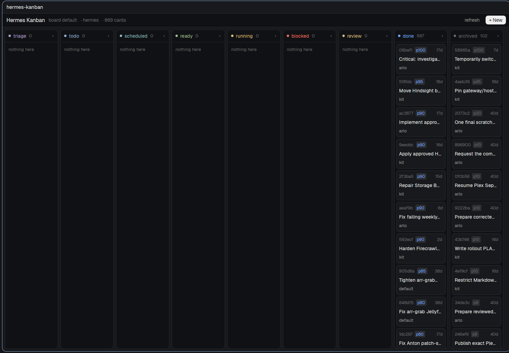

# Hermes Kanban

A native [herdr-app](https://herdr.dev) pane for the Hermes kanban board that
lives on an always-on machine. It reads and writes the board through the
`hermes kanban` CLI on a paired machine, so nothing is copied and nothing needs
a browser.



## What it does

- **Nine columns**, one per status, in the CLI's order: `triage`, `todo`,
  `scheduled`, `ready`, `running`, `blocked`, `review`, `done`, `archived`.
  Click a header to fold it; the folded set is remembered.
- **Cards** show the short id, a priority chip, the age, the title and the
  assignee. Hover a card for the full title and the start of its body.
- **Card dialog**: the body as markdown, the last 20 comments and the last 20
  events, with the status chip, assignee and age in the header.
- **Write from the pane**: create, edit, comment, assign, move and archive —
  all through the CLI, and only the moves the card's current status allows
  (`promote`, `block`, `schedule`, `unblock`, `complete`, `request-review`,
  `request-changes`, `reopen-review`, `archive`).
- **Refreshes itself** every 10 s. The last snapshot is cached, so the board is
  there the moment the pane opens, and an unreachable machine gives
  `Can't reach <machine>: <error> — retrying every 10s.` instead of an empty
  pane. A change made in one copy shows in the others within one tick.
- **Remote by default**: the board stays on the paired machine; `hc` carries
  every call.

## Keys

| Key | Does |
|---|---|
| `ctrl-alt-b` | open the board as a pane on the right |
| `r` | refresh |
| `n` | new card |
| `d` / `a` | fold or unfold `done` / `archived` |
| `Esc` | close the dialog it opened |

The board takes the keyboard when it is focused (`focusable`).

## Install

```sh
cp -r mods/hermes-kanban ~/.config/herdr-app/mods/hermes-kanban   # never overwrite an existing folder
# merge keys.json into ~/.config/herdr-app/keys.json
herdr-app check ~/.config/herdr-app/mods/hermes-kanban
```

Then `ctrl-alt-b`, or:

```sh
herdr-app do pane.split '{"direction":"right","mod":"hermes-kanban"}'
```

**Requirement:** a machine paired with `hc` — default name `hermes` — whose
`hermes kanban` works from a login shell. A layout can pass `machine`, `board`
and `folded` as props to override the defaults.

## Notes

- The board never runs `claim`, `dispatch`, `daemon` or `watch`; it only reads
  and edits cards. A card moved to `ready` is fair game for the Hermes
  dispatcher, which may start a worker — that is normal behaviour, not the mod.
- A column draws at most 100 cards, then `+N more`. `hermes kanban list` shows
  the rest.
- `Archive` is the delete-equivalent and asks first.
- `edit` cannot clear a field: an emptied field keeps the old value.

`RECIPE.md` is the full build brief — every dimension, colour, state and
command. `SPEC.md` holds the original requirements.

Part of [herdr-mods](https://github.com/v1studios-mnellis/herdr-mods), the
working repo for all of my herdr-app mods.
