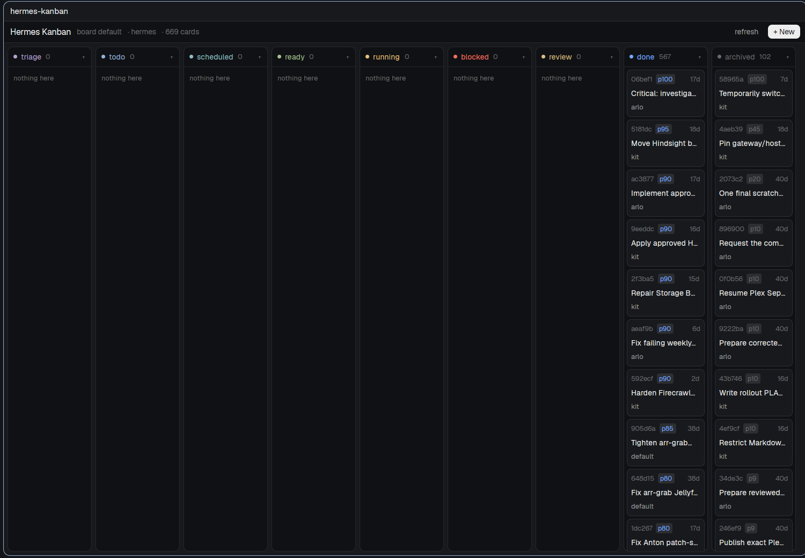

# Hermes Kanban

Hermes keeps its work board on an always-on machine. This mod draws that board
as a native herdr-app pane: one column per kanban status, the cards from
`hermes kanban list --json --archived` on the paired machine, and a card dialog
with its body, comments and events. Cards can be created, edited, commented,
assigned, moved and archived from the pane; the board refreshes itself every
ten seconds and says so plainly when the machine cannot be reached.



## What you see

Left to right, nine columns in the CLI's canonical order: `triage`, `todo`,
`scheduled`, `ready`, `running`, `blocked`, `review`, `done`, `archived`. They
share the pane's width when they can and scroll sideways when it is too narrow;
a column is between 120 and 280 logical pixels wide. Each column is a
`chrome`-colored card with a one-pixel `border`, rounded 8, holding a 30 px
header and a scrolling stack of cards.

The column header is a 6 px dot and the status name in that status's color,
then the card count in `dim`, a spacer, and `▾` or `▸`. The colors come from the
theme: `triage` `ansi5`, `todo` `ansi4`, `scheduled` `ansi6`, `ready` `ansi2`,
`running` `working`, `blocked` `blocked`, `review` `ansi3`, `done` `done`,
`archived` `dim`. An empty column says "nothing here" in `dim`.

`done` and `archived` start folded: their header shows the count and `▸`, and
their cards are not drawn. Every other column starts open.

A card shows three lines: the short id (`t_06bef1dc` → `06bef1`, `dim`, 10 px)
with a `p<priority>` chip in the status color when the priority is above zero
and the card's age on the right; the title, 11.5 px, `foreground`, one line
with an ellipsis; then the assignee in `muted`, or "unassigned" in `dim`. Cards
sit on `surface` with a `border`, rounded 6. Under the pointer the card goes
`hover` with an `input` border and a tooltip shows the full title, the id and
the first 600 characters of the body.

Above the columns, a 32 px bar on `chrome` reads "Hermes Kanban", then
"board default" or "board <slug>", then the machine name, then the total card
count; at its right an `offline` chip when something is wrong, a `refresh`
button ("loading…" while a fetch runs, a `hover` background under the pointer),
and a `+ New` button in `solid`/`solid_foreground`.

Under the bar, when a fetch fails or the machine is missing, one line on a
`blocked` tint: `Can't reach <machine>: <error> — retrying every 10s.`, with
the offline chip in the bar. Cached cards stay on the board. A write the board made itself (from its
keys) shows `<command> <id> done` in `done` green until the next tick, and a
write that fails shows its error in the same line.

The card dialog is 62% by 84% of the window on `popover`. Its first line is the
full task id, a status chip tinted like the column, `→ assignee`, `created
<age> ago`, and a `×` that closes it. Then the title at 14.5 px semibold. Then,
in a scrolling area: "Latest summary" (when the CLI has one), "Body" as
markdown, "Comments (n)" as the last 20, each with `author · age` above its
markdown, and "Events (n)" as the last 20 newest first, each with the kind in
`muted`, the payload truncated to 160 characters in `dim`, and its age. The
bottom row has a comment box and a `Comment` button, then `Edit`, `Assign`, the
moves that status allows, and `Archive`.

The new/edit dialog is 560 wide, 540 tall: a heading ("New card",
"Edit 06bef1"), a title field, a 9-row body textarea, an assignee field and a
priority field side by side, and `Cancel` / `Create` (or `Save`). The comment,
assign and reason dialogs are 560 wide, 250 tall, with one field and the same
two buttons. Errors show in `blocked` just above the buttons.

## How it behaves

- One poll: every 10 s each board copy notifies a redraw and refetches when its
  snapshot is 10 s old. There are no animation timers; the only redraw the mod
  schedules is that tick.
- Data: `hermes kanban list --json --archived` on the paired machine. The
  parsed snapshot (id, title, assignee, status, priority, body, created,
  started, completed; bodies cut to 600 characters) goes in `localStorage` under `cache`, keyed by machine
  and board, and is drawn immediately when a copy starts or reloads. The raw
  payload is never kept.
- Detail: `hermes kanban show <id> --json`, read as `.task`, `.latest_summary`,
  `.comments`, `.events`. The card dialog asks again on open, whenever another
  copy writes, and otherwise every 20 s.
- Cross-copy refresh: after every successful write the writing copy calls
  `setShared("hermes-kanban.stamp", Date.now())`. Each board copy compares that
  stamp on its tick and refetches when it changed, so a change made in a card
  dialog shows on the board within one tick without a reload.
- Machine: `props().machine`, else `shared("hermes-kanban.machine")`, else
  `"hermes"`. `hc machine ls --json` is read at start and every 60 s; a machine
  that is missing or not `connected` produces "No machine … in hc machine ls."
  or `Machine "…" is <state>.` No crash, no mod error, and the next tick
  retries.
- Board: `props().board`, else `shared("hermes-kanban.board")`, else the
  default board. It is passed as `hermes kanban --board <slug> <sub> …`.
- Columns: click a header to fold or unfold it; the folded set is kept in
  `localStorage` under `folded`. `props().folded` is an array of statuses to
  start folded, for a layout that wants a different view.
- Cards: a click opens the card dialog. Cards are ordered as the CLI returns
  them (priority by default). A column draws at most its first 100 cards and
  then a `+N more` line in `dim`.
- Writes, all through the CLI: `create <title> [--body] [--assignee]
  [--priority]`, `edit <id> [--title] [--body] [--priority]`,
  `comment <id> <text>`, `assign <id> <profile|none>`, then the moves that fit
  the card's status: `promote` (triage, todo), `block <id> [reason]`,
  `schedule <id>`, `unblock <id>` (blocked, scheduled), `complete <id>`
  (ready, running, review), `request-review <id>` (running),
  `request-changes <id> <reason>` and `reopen-review <id>` (review), and
  `archive <id>`. `Block` and `Request changes` open the reason dialog first;
  the block reason is optional, the request-changes reason is not.
- Archive is the delete-equivalent and asks first in the shipped `confirm`
  dialog with `{title, detail, command}`. The action waits in
  `shared("hermes-kanban.pending")` under a token, and the confirm button runs
  `hermes-kanban.do:<token>`. Whichever copy hears it takes the record out,
  closes the card dialog when it asked from one, and runs the archive. A
  record older than ten minutes is dropped.
- Keys with the board focused: `r` refresh, `n` new card, `d` fold/unfold
  `done`, `a` fold/unfold `archived`, all through `nextCommand()`. The board
  takes the keyboard on `focus` (`herdr-app-pane.go` reaches it because
  `mod.json` says `focusable: true`), and `Esc` closes the dialogs it opened.
- Hover, focus and disabled states: buttons brighten to 85% opacity, rows take
  `hover`, and a button is `dim` and inert while a write is in flight.

## Built from

One mod, `mods/hermes-kanban/`:

- `main.js` — the `View`: board, columns, cards, the card dialog, the form
  dialogs, the poll, the writes and the command loop.
- `lib.js` — pure helpers: `STATUSES`, `FOLDED_BY_DEFAULT` (`done`,
  `archived`), `TONE`, `MOVES` (each status's label, command and whether it
  needs a reason), `shortId`, `duration`, `age`, `hermesArgv`, `parseList`,
  `parseShow`.
- `mod.json` — `{"place": "none", "title": "Hermes Kanban", "focusable":
  true}`: no docked copy by default; a layout, `pane.split` or `mod.open` puts
  it somewhere.
- `keys.json` — a `global` binding `ctrl-alt-b` →
  `{"command": "pane.split", "args": {"direction": "right", "mod":
  "hermes-kanban"}}`, and a `mod:hermes-kanban` section with `r`, `n`, `d`, `a`.

The `herdr` functions used: `exec`, `hc`, `props`, `shared`, `setShared`,
`theme`, `nextCommand`, `openOverlay`, `closeOverlay`. Widgets: `v_flex`,
`h_flex`, `div`, `TextView.markdown`, `InputState`/`Input`,
`TextareaState`/`Textarea`. Every color comes from `theme()`; keys, poll, and
writes use `cx.timer.every`, `cx.spawn` and `nextCommand()` — no `setTimeout`,
no top-level `await`, no DOM, HTML, CSS or Node APIs.

The one command shape, with the login shell because herdr-core starts programs
without one and the core's `PATH` need not include `~/.local/bin`:

```
bash -lc 'exec hermes "$@"' hermes kanban [--board <slug>] <subcommand> <args…>
```

run as `exec("bash", ["-lc", 'exec hermes "$@"', "hermes", "kanban", …],
{ on: <machine>, timeout: 30000 })`. Every later argument is passed as an
argument, never as shell text. `"$@"` keeps titles and comments with quotes,
newlines or leading dashes intact.

Props it reads: `machine`, `board`, and `folded` (an array of statuses). Shared
state it reads or writes: `hermes-kanban.machine`, `hermes-kanban.board`,
`hermes-kanban.stamp`, `hermes-kanban.pending`. It also uses the shipped
`confirm` mod for the archive dialog, and nothing else.

## Watch out

- `exec` on a remote machine does **not** use a shell, and `hermes` lives in
  `~/.local/bin` there: calling `exec("hermes", …)` fails with
  `spawn_failed`. The `bash -lc 'exec hermes "$@"'` wrapper is what makes it
  work, and `"$@"` is what keeps user text out of the shell. Do not
  interpolate arguments into the `-lc` string.
- The list payload includes every task's body: on a board with ~670 finished
  cards it is about 1.9 MB and takes ~1–3 s. That is why the poll is 10 s per
  copy, the cached snapshot cuts each body to 600 characters, and the timeout is 30 s.
  A very large board makes the poll heavier; raise `TICK` if that matters
  more than freshness.
- Only one copy should run a confirmed action: the pending record is keyed by
  a token and removed by the first copy that hears `hermes-kanban.do:<token>`.
  Copying the gitview discard pattern matters here; running from a plain
  `shared` flag would archive twice.
- `edit` cannot clear a body: the dialog only sends `--body` when the field is
  non-empty, because `--body ""` is not the same as "leave it". Title and
  priority are always sent when non-empty.
- `complete` on a blocked card is refused by the CLI; the dialog only offers
  the moves `MOVES` lists for the card's current status, so no button sends a
  known-bad combination. Any other refusal is shown in the dialog in `blocked`
  red and in the board's offline line if the board made the write.
- The board is read-only about work: it never runs `claim`, `dispatch`,
  `daemon` or `watch`. A card moved to `ready` is fair game for the Hermes
  dispatcher, which may start a worker; that is the board's normal behavior,
  not the mod's.
- A folded column keeps its cards in the data, not on screen: `done` on a busy
  board hides hundreds of cards, and a column never draws more than 100 at
  once. `hermes kanban list` is the way to see the rest.
- No drag-and-drop, no toasts or sounds for board changes, and no live push
  from the machine: changes land within one 10 s tick.
- Install: copy `mods/hermes-kanban/` into `~/.config/herdr-app/mods/`,
  merge this `keys.json` into the person's (ask before replacing a key), and
  run `herdr-app check ~/.config/herdr-app/mods/hermes-kanban`. Never
  overwrite an existing mod folder named `hermes-kanban`. It assumes a paired
  machine named `hermes` (or `props.machine`/`shared("hermes-kanban.machine")`)
  whose `hermes kanban` works from a login shell — on this laptop that machine
  is the ssh target `anton-djed` (100.111.229.49).

## Done when

- `herdr-app check ~/.config/herdr-app/mods/hermes-kanban` exits 0, and
  `herdr-app status` lists no errors after the pane has been open a minute.
- `herdr-app do pane.split --direction right --mod hermes-kanban` shows the
  nine columns, and each column's count equals that status's count in
  `ssh anton-djed 'hermes kanban list --json --archived'` (669 cards, 567
  `done`, 102 `archived` on the default board when this was written). Click
  `done`'s header and the cards appear.
- Clicking a card shows its body, comments and events, matching
  `hermes kanban show <id> --json` (`.task`, `.comments`, `.events`).
- `+ New` creates a card: it is in `hermes kanban list --json` and in its
  column within one tick. `Comment`, `Edit`, `Assign` and a move change the
  card on the machine the same way, without a reload.
- `Archive` asks in the confirm dialog; after confirming, the card leaves the
  board and `hermes kanban list --json --archived` shows it `archived`.
- With an unpaired or unreachable machine (a pane with `{"machine": "nope"}`),
  the board shows `Can't reach nope: … — retrying every 10s.`, keeps its
  cached cards, and `herdr-app status` still reports no mod error.
- `herdr-app do mod.open --name hermes-kanban` opens the same board as an
  overlay; `herdr-app do tab.new --name Kanban --mod hermes-kanban --props
  '{"folded": []}'` opens it as a tab with `done` and `archived` unfolded,
  which is how `preview.png` was taken.
